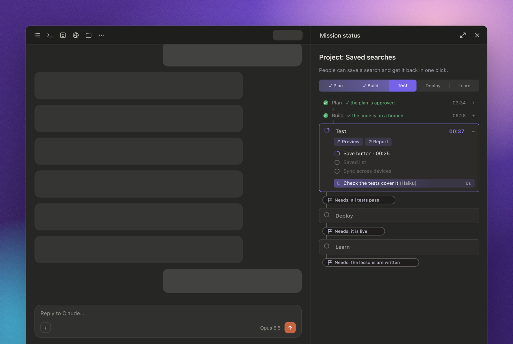

<h1 align="center">🚀 mission-status</h1>

<p align="center"><b>Know where your agent stands, without reading through its work.</b></p>

<p align="center"></p>

<p align="center">
  <a href="LICENSE"></a>
  <a href="https://github.com/oficiallyAkshay/clonometer"></a>
</p>

<p align="center">Works with<br>
  <a href="https://github.com/anthropics/claude-code"></a>
</p>

## Features

mission-status is a live progress pane for Claude Code in the Claude desktop app. It sits beside the chat and shows the goal, the stages, what done means for each stage, and where the work is right now.

<p align="center">👀<br><b>Read in a glance</b><br>The goal, the current stage and its gate show on one screen, so you never ask "where are we?" again.</p>

<p align="center">🧭<br><b>Fits any work</b><br>Features, bug fixes, incidents, research or your own saved stages: the pane changes shape with the work.</p>

<p align="center">🔁<br><b>Stays current</b><br>The agent keeps it up to date, and the pane reminds it when the view goes stale.</p>

<p align="center">🤫<br><b>A quiet chat</b><br>The chat holds only what needs you: a decision, an approval, or a step only you can do.</p>

<p align="center">🔒<br><b>Private stays private</b><br>Usage counts are anonymous, never hold your words, files or names, and turn off with one command.</p>

<p align="center">📊<br><b>Live numbers</b><br>Git, pull requests, checks and helpers come from their own sources, read while the pane is open.</p>

## Fit

**Use it when**
- your sessions run long, with several stages, helpers and pull requests;
- you want to follow a session without reading the chat;
- you follow a runbook or a checklist and want each step tracked.

**Look elsewhere when**
- you work in the terminal or an editor: the pane shows only in the Claude desktop app;
- you want progress bars above the prompt: [zycck/claude-mods](https://github.com/zycck/claude-mods) draws those.

Install it from a Claude Code session in the Claude desktop app:

```
/plugin marketplace add oficiallyAkshay/mission-status
/plugin install mission-status@mission-status
```

The pane opens by itself once a session does real work, and `/mission-status` opens it at any time.

## How it compares

| | [oficiallyAkshay/mission-status](https://github.com/oficiallyAkshay/mission-status) | [zycck/claude-mods](https://github.com/zycck/claude-mods) |
|---|---|---|
| Place | Side pane | Above prompt |
| Stage gates | ✅ | ❌ |
| Merge state | ✅ | ❌ |
| Runbook tabs | ✅ | ❌ |
| Quiet chat | ✅ | ❌ |
| Terminal | ❌ | ✅ |
| Sounds | ❌ | ✅ |

## Security and limits

No credential by default. The pane runs inside Claude Code on your machine, and it calls no model of its own unless you turn on the state marker below.

- ❎ sends your prompts, goals, files, branch names or paths anywhere
- ❎ names your account or session in any event
- ❎ installs an update during a turn

**Optional state marker (Jev).** Off unless `JEV_API_KEY` is in the environment of Claude Code (for example under `env` in `~/.claude/settings.json`). When it is set, about every 30 s after new tool calls the pane asks Jev, TypeSafe's decision model (`jev-1.13.0`, `POST https://api.typesafe.ai/v1/systemone`), which items are now done, in progress or failed, and where a new item with no parent belongs. It sends every item's name, stage and state, and every tool-call line in the last 256 KiB of the session's transcript: the tool, its target (a command's description or the command, a file's name, a search pattern, a URL) and how it ended (ok, error, or a Bash command's last output line). It never sends file contents or other tool output. A mark shows as "inferred" until the agent's next update, which always wins; a placed parent stays, and the agent's own parent wins. A bad or unsure answer changes nothing; three refusals in a row stop it for the session. TypeSafe's terms and privacy policy apply to what it receives.

By default anonymous usage counts are on after the onboarding shows them; `/pane-metrics off` stops them, and `CLAUDE_CODE_DISABLE_NONESSENTIAL_TRAFFIC` stops every send. Every event and field is listed in [docs/telemetry.md](docs/telemetry.md). By default the plugin updates itself between turns; the onboarding switch or the pane's Turn on auto-update button sets it.
